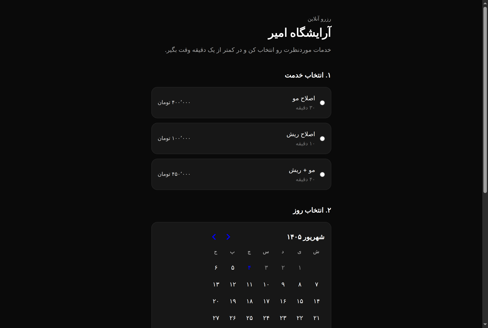

# 💈 brbitime — رزرو آنلاین آرایشگاه

**🔴 Live:** [muucut.ir](https://muucut.ir)



Online appointment booking platform for salons and barbershops. Customers pick a service,
a day, and a time slot; the customer and owner receive instant SMS notifications and the barber manages bookings from a password-protected panel.

Built with Next.js (App Router), React 19, Tailwind CSS 4, Neon serverless
Postgres, and Kavenegar/FarazSMS API. Fully RTL / Persian-first.

## Features

- Mobile-first RTL booking flow: service → Persian-calendar day → time slot → contact info
- Live availability: booked slots are disabled and double-bookings are rejected at the DB level (`UNIQUE` constraint)
- Instant SMS alert to customer & barber on every new booking (non-blocking)
- Automated 30-minute appointment reminder SMS via background Vercel cron
- Instant SMS alert to barber on customer cancellation
- Owner panel at `/admin` (password login, HMAC-signed session cookie): upcoming appointments, cancel, logout
- Business & Funnel Analytics at `/admin?tab=analytics`: estimated revenue, conversion funnel, service breakdown, peak days & hours, marketing attribution (Instagram/SMS/Direct), and live activity stream
- Confirmation page with the customer's own booking details

## Environment variables

| Variable | Required | Purpose |
| --- | --- | --- |
| `DATABASE_URL` | ✅ | Neon Postgres connection string |
| `ADMIN_PASSWORD` | ✅ | Owner panel password |
| `ADMIN_SESSION_SECRET` | ✅ | Any long random string (signs the session cookie) |
| `CRON_SECRET` | optional | Bearer secret for `/api/cron/reminders` |
| `BARBER_PHONE` | optional | Barber phone number(s) receiving booking/cancel SMS |
| `SMS_PROVIDER` | optional | `kavenegar` or `farazsms` |
| `NEXT_PUBLIC_APP_URL` | optional | Public canonical URL (`https://muucut.ir`) |

## Database schema

```sql
CREATE TABLE IF NOT EXISTS appointments (
  id SERIAL PRIMARY KEY,
  public_id UUID NOT NULL DEFAULT gen_random_uuid(),
  service TEXT NOT NULL,
  appointment_date DATE NOT NULL,
  appointment_time TEXT NOT NULL,
  customer_name TEXT NOT NULL,
  phone TEXT NOT NULL,
  status TEXT NOT NULL DEFAULT 'booked',
  created_at TIMESTAMPTZ NOT NULL DEFAULT now()
);

-- one booking per slot per day:
CREATE UNIQUE INDEX IF NOT EXISTS appointments_slot_unique
  ON appointments (appointment_date, appointment_time)
  WHERE status = 'booked';

-- barber unavailable times / leaves:
CREATE TABLE IF NOT EXISTS unavailable_times (
  id SERIAL PRIMARY KEY,
  date TEXT NOT NULL,
  time TEXT NOT NULL,
  note TEXT,
  created_at TIMESTAMPTZ NOT NULL DEFAULT now()
);

CREATE UNIQUE INDEX IF NOT EXISTS unavailable_times_date_time_unique
  ON unavailable_times (date, time);
CREATE INDEX IF NOT EXISTS unavailable_times_date_idx
  ON unavailable_times (date);

-- first-party business & funnel analytics:
CREATE TABLE IF NOT EXISTS analytics_events (
  id BIGSERIAL PRIMARY KEY,
  event_name TEXT NOT NULL,
  event_data JSONB DEFAULT '{}',
  path TEXT NOT NULL DEFAULT '/',
  referrer TEXT,
  utm_source TEXT,
  utm_medium TEXT,
  utm_campaign TEXT,
  device_type TEXT,
  session_id TEXT,
  created_at TIMESTAMPTZ NOT NULL DEFAULT now()
);

CREATE INDEX IF NOT EXISTS idx_analytics_events_created_at ON analytics_events(created_at DESC);
CREATE INDEX IF NOT EXISTS idx_analytics_events_event_name ON analytics_events(event_name);
CREATE INDEX IF NOT EXISTS idx_analytics_events_utm_source ON analytics_events(utm_source);
```

## Develop

```bash
bun install
bun dev        # http://localhost:3000
bun run lint   # eslint
bun run build  # production build
```

Shop config (name, phone, Instagram) lives in `lib/shop.ts`;
services and time slots in `lib/booking.ts`.
